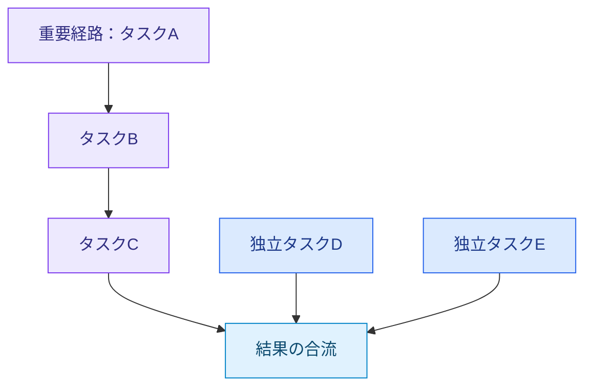
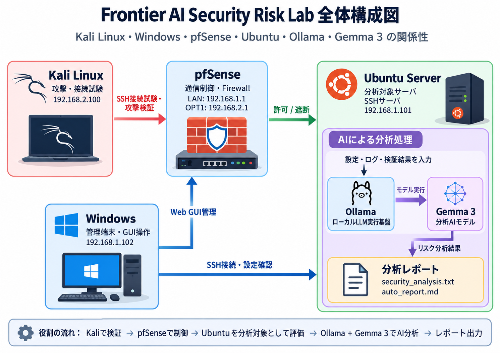

# 小林 智輝 / Tomoki Kobayashi

**GPUの性能を引き出す研究と、生成AIを活用したセキュリティリスク分析・対策検証に取り組んでいます。**

北陸先端科学技術大学院大学（JAIST）情報科学系・修士1年。数学科出身。  
強みは、課題を論理的に整理し、**分析・実装・検証・改善まで一貫して進める力**です。

[修士研究](https://github.com/kcs-j02/master_study) · [AIセキュリティリスク分析](https://github.com/kcs-j02/Frontier-AI-Security-Risk-Lab) · [セキュリティ基礎学習](https://github.com/kcs-j02/security) · [自主開発](https://github.com/kcs-j02/my_app)

---

## 修士研究｜GPUタスクスケジューリング・資源配分

AIなどの計算処理を高速化するため、**タスクの依存関係とGPU計算資源の配分を考慮したスケジューリング手法**を研究しています。

複数の処理を並列に実行すると、資源競合によって重要なタスクが遅れ、全体の実行時間が増加する場合があります。

そこで、タスクの重要度とGPU資源の使用状況を考慮し、実行先と計算資源の配分を最適化する手法を検討しています。

### 対象とする依存構造の概念例

**重要な依存経路を優先しながら、独立タスクの並列実行を維持すること**を目指します。

| 取り組み | 内容 |
|---|---|
| 分析・設計 | 依存グラフとbottom levelからタスク重要度を算出 |
| 実装 | C++・CUDAでStream配置とGPU計算資源の配分を実装 |
| 評価 | NVIDIA H100上で11ベンチマーク・4手法を比較 |
| 改善 | 実行時間とGPU稼働率からボトルネックを分析 |

### 研究成果

長い依存経路と並列タスクが混在する合成グラフにおいて、既存手法比**約9.1%の実行時間短縮**を確認しました。

一方、実アプリケーション由来の6種類では改善に至っておらず、カーネルの処理特性を考慮した予測モデルの改善を進めています。

**使用技術：** C++ / CUDA / CUDA Stream / CUDA Green Context / Taskflow / Nsight Systems・Compute

→ [研究コード・評価結果：master_study](https://github.com/kcs-j02/master_study)

---

## セキュリティ｜生成AIを活用したリスク分析・対策検証

**サイバー攻撃による被害を防ぎ、誰もが安心してICTサービスを利用できる環境を支えること**を目指し、セキュリティの自主学習に取り組んでいます。

現在は、NTTドコモビジネスのCRXソリューションにおける「フロンティアAI」を参考に、**生成AIによるリスク分析から対策・効果検証までの流れを疑似体験する環境**を構築しています。

### 検証環境の全体構成

VMware Workstation上にKali Linux、Ubuntu Server、Windows 11、pfSenseを構築し、隔離した仮想ネットワークでセキュリティ検証を実施しています。

さらに、Ubuntu Server上にOllama・Gemma 3を導入し、ローカル生成AIによるリスク分析環境を構築しました。

| 構成要素 | 役割 |
|---|---|
| Kali Linux | セキュリティ検証・接続試験 |
| Ubuntu Server | 保護対象サーバー・ローカルAI実行 |
| Windows 11 | 正規の管理端末 |
| pfSense | ネットワーク間の通信制御・ログ記録 |
| Ollama / Gemma 3 | SSH設定・ネットワーク構成のリスク分析 |
| Python | AI分析処理・結果保存・レポート生成 |

### 取り組み｜SSH接続のリスク分析・対策検証

Ubuntu ServerのSSH設定とネットワーク構成を対象に、**リスク分析 → 接続試験 → 対策 → 効果検証**を実施しました。

| 工程 | 取り組み | 状態 |
|---|---|---|
| 環境構築 | Kali・Ubuntu・Windows・pfSenseの構築 | 完了 |
| 情報収集 | SSH設定・ネットワーク構成の確認 | 完了 |
| 接続制御 | pfSenseによる不要なSSH通信の遮断 | 完了 |
| 認証強化 | パスワード認証から公開鍵認証への移行 | 完了 |
| 効果検証 | 接続試験・通信ログ・認証ログの確認 | 完了 |
| ローカルAI分析 | Ollama・Gemma 3による設定リスクの分析 | 完了 |
| AI分析結果の評価 | AIの判断と実測結果の比較 | 完了 |
| 分析処理の自動化 | Pythonによる分析・レポート生成スクリプトの作成 | 完了 |
| Webアプリへの展開 | 認証・アクセス制御のリスク分析 | 未着手 |

### 検証結果

**不要なSSH通信を遮断しながら、正常な管理接続を維持できることを確認しました。**

- **通信制御：** KaliからUbuntuへのSSH接続をpfSenseで遮断し、ログで確認
- **認証強化：** SSHのパスワード認証を無効化し、公開鍵認証への移行を確認
- **AI分析：** Gemma 3でSSH設定とファイアウォールルールを分析
- **AIの誤判断：** 無効化された許可ルールを誤って解釈する事例を確認
- **分析処理：** PythonからOllama APIを呼び出す分析スクリプトとレポート生成スクリプトを作成

今回の検証から、**生成AIはリスク分析を支援できる一方、その判断を実際の設定・通信試験・ログと照合することが重要**だと分かりました。

今後はAI分析の正確性と再現性を高め、Webアプリケーションの認証・アクセス制御にも検証対象を広げていきます。

※本実験は独自の学習環境であり、実際のCRX製品やフロンティアAIの内部機能を使用・再現したものではありません。

**使用技術：** Python / Ollama / Gemma 3 / VMware Workstation / Kali Linux / Ubuntu Server / Windows 11 / pfSense / OpenSSH

→ [実験構成・検証結果・AI分析コード：Frontier-AI-Security-Risk-Lab](https://github.com/kcs-j02/Frontier-AI-Security-Risk-Lab)

→ [セキュリティ基礎学習：security](https://github.com/kcs-j02/security)

---

## その他の取り組み

| プロジェクト | 内容 |
|---|---|
| [学士研究](https://github.com/kcs-j02/my-Bachelor-study) | PythonでQ学習・DQNを実装。迷路・CartPoleで収束速度と学習の安定性を比較 |
| [エアコン遠隔操作](https://github.com/kcs-j02/my_app) | サーバーとデバイスの連携を実装。擬似デバイスで動作を検証 |
| [大学院入試の実装演習](https://github.com/kcs-j02/entrance-exam) | プログラミング問題をCで再現・実装 |

---

## 技術

**開発：** C++ / CUDA / Python / C / JavaScript

**環境・分析：** Linux / Git / CMake / VMware Workstation / pfSense / OpenSSH / Ollama / Gemma 3 / Nsight Systems / Nsight Compute

---

## Contact

GitHub：[kcs-j02](https://github.com/kcs-j02)
