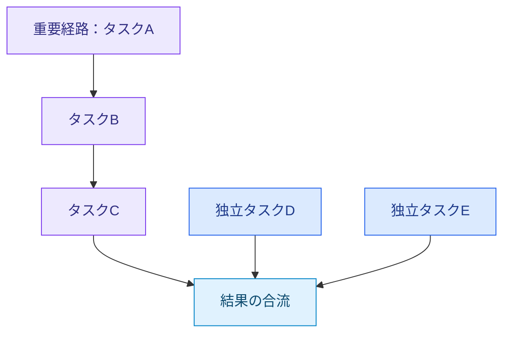
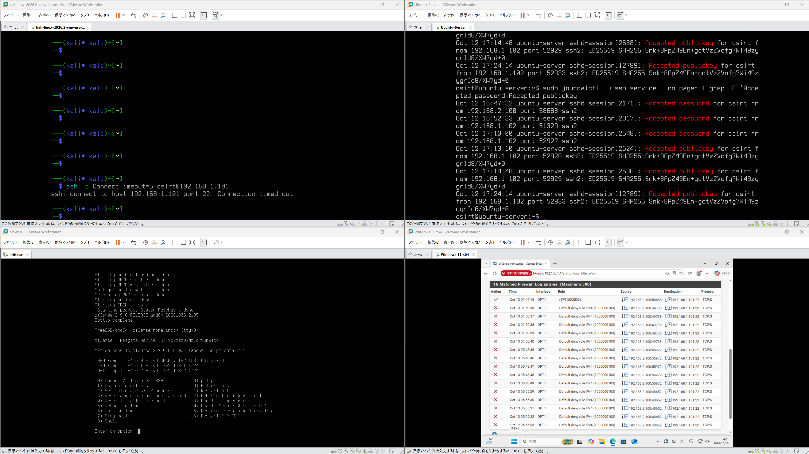

# 小林 智輝 / Tomoki Kobayashi

**GPUの性能を引き出す研究と、生成AIを活用したセキュリティリスク分析・対策検証に取り組んでいます。**

北陸先端科学技術大学院大学（JAIST）情報科学系・修士1年。数学科出身。  
強みは、課題を論理的に整理し、**分析・実装・検証・改善まで一貫して進める力**です。

[修士研究](https://github.com/kcs-j02/master_study) · [セキュリティ学習](https://github.com/kcs-j02/security) · [自主開発](https://github.com/kcs-j02/my_app)

---

## 修士研究｜GPUタスクスケジューリング・資源配分

AIなどの計算処理を高速化するため、**タスクの依存関係とGPU計算資源の配分を考慮したスケジューリング手法**を研究しています。

複数の処理を並列に実行しても、重要な処理が資源競合で遅れると、全体の完了が遅くなります。  
そこで、処理の重要度に応じて実行先とGPU資源を配分し、全体の実行時間を短縮する方法を検討しています。

### 対象とする依存構造の概念例

**重要な依存経路を進めながら、独立タスクの並列実行を維持する**ことを目指します。

| 取り組み | 内容 |
|---|---|
| 分析・設計 | 依存グラフとbottom levelからタスク重要度を算出 |
| 実装 | C++・CUDAでStream配置と計算資源（SM）の配分を実装 |
| 評価 | NVIDIA H100上で11ベンチマーク・4手法を比較 |
| 改善 | 実行時間とGPU稼働率からボトルネックを分析 |

現時点の測定では、長い依存経路と並列タスクが混在する合成グラフで、既存手法比**約9.1%の実行時間短縮**を確認しました。

一方、実アプリケーション由来の6種類では改善に至っておらず、カーネルの処理特性を反映した予測モデルの改善を検討しています。

**使用技術：** C++ / CUDA / CUDA Stream / CUDA Green Context / Taskflow / Nsight Systems・Compute

→ [研究コード・測定条件・評価結果：master_study](https://github.com/kcs-j02/master_study)

---

## セキュリティ｜生成AIを活用したリスク分析・対策検証

**サイバー攻撃による被害を防ぎ、誰もが安心してICTサービスを利用できる環境を支えること**を目指して、セキュリティの自主学習に取り組んでいます。

現在は、NTTドコモビジネスのCRXソリューションにおける**「フロンティアAI」を参考に、生成AIによるセキュリティリスク分析から対策・効果検証までの一連の流れを疑似体験**しています。

### 検証画面 

VMware Workstation上でKali Linux、Ubuntu Server、pfSense、Windows 11を起動し、SSH接続の制御と認証ログの分析を実施しました。

- **Kali Linux（左上）：** 対策後のSSH接続がタイムアウトすることを確認
- **Ubuntu Server（右上）：** パスワード認証から公開鍵認証への移行をログで確認
- **pfSense（左下）：** WAN・LAN・OPT1のネットワーク構成と通信制御を確認
- **Windows 11（右下）：** パケットフィルタの遮断ログと正常なSSH接続を比較

### 取り組み｜SSH接続設定のリスク分析・対策検証

VMware Workstation上にKali Linux、Ubuntu Server、Windows 11、pfSenseを構築し、隔離した仮想ネットワークでSSH接続のセキュリティ検証を実施しました。

| 工程 | 取り組み |
|---|---|
| 情報収集 | UbuntuのSSH設定とネットワーク構成を確認 |
| リスク分析 | 生成AIを活用し、認証方式や接続許可範囲のリスクを分析 |
| 実機検証 | KaliからUbuntuへのSSH接続試験を実施 |
| 対策 | pfSenseによる接続元制限とSSH公開鍵認証への移行 |
| 効果検証 | 接続試験とファイアウォール・認証ログから対策結果を確認 |

### 検証結果

**管理端末以外からもSSH接続できる状態を確認し、不要な通信を遮断しながら正常な管理接続を維持できることを検証しました。**

- **対策前：** KaliからUbuntuへのSSH接続に成功
- **対策後：** pfSenseでKaliからのSSH通信を遮断
- **正常接続：** WindowsからUbuntuへのSSH接続を維持
- **認証強化：** パスワード認証を無効化し、公開鍵認証へ移行
- **ログ分析：** pfSenseの遮断ログとUbuntuの認証ログで結果を確認

生成AIの分析結果をそのまま採用するのではなく、**実際の設定・接続結果・ログと照合し、対策の妥当性を検証すること**を重視しています。

この比較から、**許可された管理端末の接続は維持しつつ、許可されていない接続元は遮断される**ことを確認しました。

今後はWebアプリケーションの認証・アクセス制御にも検証対象を広げ、リスクの発見から対策・効果検証までの分析力を高めていきます。

※実際のCRX製品を使用したものではなく、その取り組みを参考に構築した独自の学習環境です。

**使用技術：** VMware Workstation / Kali Linux / Ubuntu Server / Windows 11 / pfSense / OpenSSH / Linux / 生成AI

→ [セキュリティ実験・検証結果：security](https://github.com/kcs-j02/security)

---

## その他の取り組み

| プロジェクト | 内容 |
|---|---|
| [学士研究](https://github.com/kcs-j02/my-Bachelor-study) | PythonでQ学習・DQNを実装。迷路・CartPoleで収束速度と学習の安定性を比較 |
| [エアコン遠隔操作](https://github.com/kcs-j02/my_app) | サーバーとデバイスの連携を実装。擬似デバイスで動作を検証 |
| [大学院入試の実装演習](https://github.com/kcs-j02/entrance-exam) | プログラミング問題をCで再現・実装 |

---

## 技術

**開発：** C++ / CUDA / Python / C / JavaScript

**環境・分析：** Linux / Git / CMake / VMware Workstation / pfSense / OpenSSH / Nsight Systems / Nsight Compute

---

## Contact

GitHub：[kcs-j02](https://github.com/kcs-j02)
